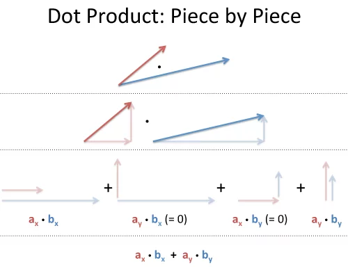

# Discussion 7  

Slides: https://docs.google.com/presentation/d/1pCidvq2lWP_aUdU4vLHB4G1y8t0jJqK0XJgOj5k74u8/edit?slide=id.g40a0bf5c01d_1_0#slide=id.g40a0bf5c01d_1_0

- The slides contain a brief tie-in to a known bioinformatics tool for k-mer counting, Kraken 2 (https://github.com/DerrickWood/kraken2)
- Please create a slide for your group and answer the following questions

In lecture, we discussed `std::map` as a general-purpose _associative container_. That is, this container associates a _key_ to a _value_. `std::map` is somewhat analogous to a python `dict`, although there is a container that is closer to a `dict` - `std::unordered_map`.

## Reading C++ documentation

There are multiple sites with C++ documentation, but [cppreference](https://en.cppreference.com/w/) is typically considered the best source. In particular we are going to use this site to compare/contrast these two containers. Here are direct links to the documentation:

  * [std::map](https://en.cppreference.com/w/cpp/container/map)
  * [std::unordered_map](https://en.cppreference.com/w/cpp/container/unordered_map)

### Some questions

1. The descriptions of these containers are similar, but there is a crucial difference (and not just that one is not ordered). What is that difference, and why it is important?
2. What are the template arguments for each container? (You don't need to look at the version that says `since C++17`)
3. What kinds of keys can you use with `std::map` and not `std::unordered_map`? Why is this restriction there?
4. In `main.cpp`, show an example of a `key` type that works with `std::map` but not with `std::unordered_map`.
5. If your application could use either, which one would you choose, and why?

### Another container type

The website also lists all the container types [here](https://en.cppreference.com/w/cpp/container). As a group, pick a container that was not shown in lecture and look at its documentation. Report out what it is, and what its use cases are. Also, include if you can think of or find a similar container in python.


## Exceptions

### The try/catch pattern

C++ exceptions work a lot like they do in Python: `raise` becomes `throw`, and `try`/`except` becomes `try`/`catch`. A thrown exception skips the rest of the `try` block and jumps to the nearest matching `catch`. If nothing catches it, the program terminates.

```c++
double divide(double a, double b)
{
    if (b == 0.0)
        throw std::runtime_error("Division by zero");
    return a / b;
}

try {
    std::cout << divide(1.0, 0.0) << "\n";
    std::cout << "Done dividing\n";
}
catch (const std::runtime_error & ex) {
    std::cout << "Caught: " << ex.what() << "\n";
}
```

- `try { ... }` wraps code that might throw.
- `throw` creates an exception object (here a `std::runtime_error` holding a message) and sends it up.
- `catch (const std::runtime_error & ex)` catches exceptions of that type.

The standard exception types live in `<stdexcept>`, so `#include <stdexcept>` if you try these examples yourself.

1. What does this code print? Which lines never run, and why?
2. What does the `what()` function do?

### Multiple catch blocks

A `try` can be followed by several `catch` blocks in a row. All of the standard exception types, including `std::runtime_error`, inherit from `std::exception`.

```c++
try {
    throw std::runtime_error("This is an error");
}
catch (const std::runtime_error & ex) {
    std::cout << "Caught a runtime_error: " << ex.what() << "\n";
}
catch (const std::exception & ex) {
    std::cout << "Caught an exception: " << ex.what() << "\n";
}
```

3. What does this code print? Does the second `catch` block run?
4. Suppose we throw a different exception instead: `throw std::out_of_range("Index too large");`. Does the code still compile? Which `catch` block runs, and what gets printed?
5. In question 4, the second `catch` declares `ex` as a `const std::exception &`. What type is the object that `ex` actually refers to? Does `ex.what()` print a generic `std::exception` message, or something else?

## Raw Pointer Review

An array of N elements can be allocated using the `new` operator

```c++
double * a1 = new double[N];
double * a2 = new double[N];
double * a3 = new double[N];
```

Elements of the array can then be accessed using the square brackets:

```c++
// First elements of two arrays multiplied, and stored in another array
a3[0] = a1[0] * a2[0];
```


### Questions
1. Given the above allocations, how would you free them when you are done with them?
2. What's the difference between `double * arr = new double[N]` and `double arr[N]`?


## Pointer Arithmetic

Underneath, pointers are just integers (typically 64-bit unsigned integers). That means you can do math on them!
Adding (with an integer) results in a pointer that is _offset_ by that many elements.

Notably, the name of the array is analogous to a pointer to its first element. That is,
`(*arr) = arr[0]`. More precisely, C-style arrays _decompose_ into pointers, and pointers can be
used like arrays.

Given an array filled with integers,

```c++
    int * x = new int[10];
    for(int i = 1; i < 11; i++)
    {
        x[i-1] = i * 3;
    }
```

### Questions

Try to answer these without running the code, but try it out if you are stuck

1. What is the value of `x[2]`?
2. What is the value of `(*x)`?
3. Where does `(x + 4)` point to? What is the value of `*(x+4)`?
4. What is another way to write `(x+7)`?

## Pointers with algorithms

Raw pointers can be used with algorithms in the standard library. That is, pointers can behave like iterators.
For example, `arr` would be the beginning of the array and `arr+10` would be the end (one past the last element) of a
10-element array

**Question:** Why is `arr+10` one past the end of a 10-element array? Why isn't it the last element?

### Questions

Given a C-style array and `std::vector` below:

```c++
    int arr[] = {3, 11, -2, 4, 8, -3, -4, 10, 1, 0};
    std::vector<int> vec{3, 11, -2, 4, 8, -3, -4, 10, 1, 0};
```

1. How would you fill both of these objects with zero?
2. How could you sort only the first 4 elements?
3. How could you copy the first 5 elements vector `vec` into the array `arr`?

## Vector dot product

The dot product of two vectors is computed by summing the product of each element. The result is a single number



We can do this a few different ways using the standard library. Write the code for doing the dot product
of the above array and vector the following to ways.

1. Use `std::transform` to perform the product, and then `std::accumulate` to accumulate the sum
2. Use `std::inner_product`

For #1, You can use `std::multiplies<int>()` as the argument for the binary operation.

See:
- https://en.cppreference.com/w/cpp/algorithm/transform 
- https://en.cppreference.com/w/cpp/algorithm/accumulate 
- https://en.cppreference.com/w/cpp/algorithm/inner_product

## One More Question

These algorithms are written in a very generic way, using templates. Do you think this a good approach? What are the benefits and drawbacks of this approach?
